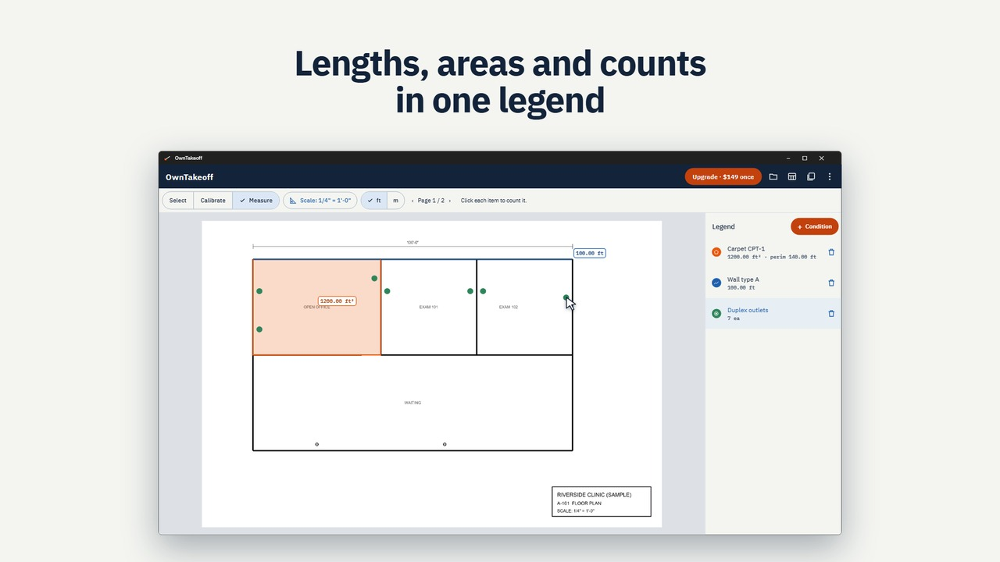
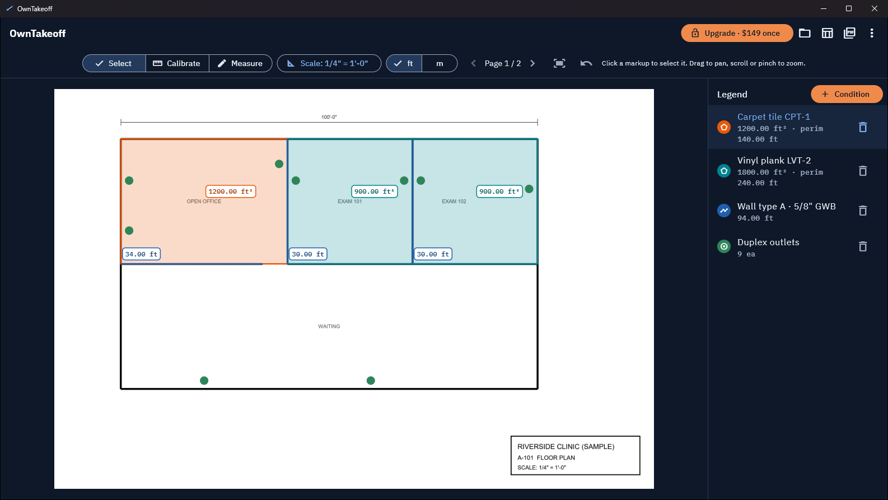
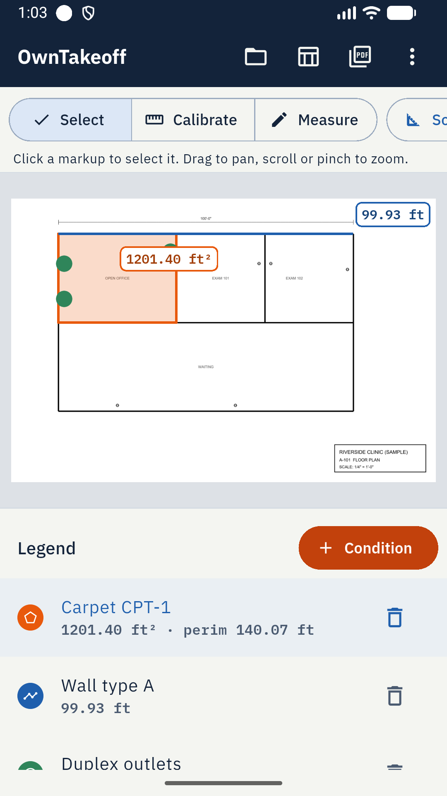

# OwnTakeoff: PDF Plan Takeoff

Measure lengths, areas and counts on PDF building plans, then send the quantities to Excel. A takeoff tool you buy once and keep, for Windows and Android.

## What it does

Open a plan set, set the scale, and measure what you need to price the job: wall runs, floor and roof areas, perimeters and fixture counts. It is built for estimators and trades (electrical, drywall, flooring, roofing, painting, concrete) who price work from drawings.

- **Scale:** architectural presets from 1/16" = 1'-0" to 3" = 1'-0", engineering scales, metric 1:10 to 1:1000, or calibrate from any known dimension
- **Measure:** length, area with perimeter, and counts, with live totals as you click
- **Conditions:** one per item you price ("Wall type A", "Carpet", "Duplex outlets"), each with its own colour and a legend with running totals across every page
- **Export:** quantities as CSV for Excel or Google Sheets, and a marked-up PDF with a legend on each page
- **Private:** plans and takeoffs stay on your computer or phone; it works offline and needs no account

| Windows | Android |
|---|---|
|  |  |

## Pricing

- **Windows:** free to use with 3 conditions per project and CSV export. Pro is **$149 one-time**: unlimited conditions and the marked-up PDF. Each key works on 2 computers, and you can move it to a new laptop from inside the app. No subscription.
- **Android:** free with ads. Exports unlock after one short video.

## Links

- Website: https://owntakeoff.pages.dev/
- Microsoft Store: https://apps.microsoft.com/detail/9PFMC7RTT9WG
- Google Play: https://play.google.com/store/apps/details?id=com.nktools.owntakeoff
- Demo video: https://youtu.be/D0mo3xcjdNo
- Privacy policy: https://owntakeoff.pages.dev/privacy/
- Support: anithabheesetty@gmail.com

This repository is the product page for OwnTakeoff. The app's source code is not published here.
